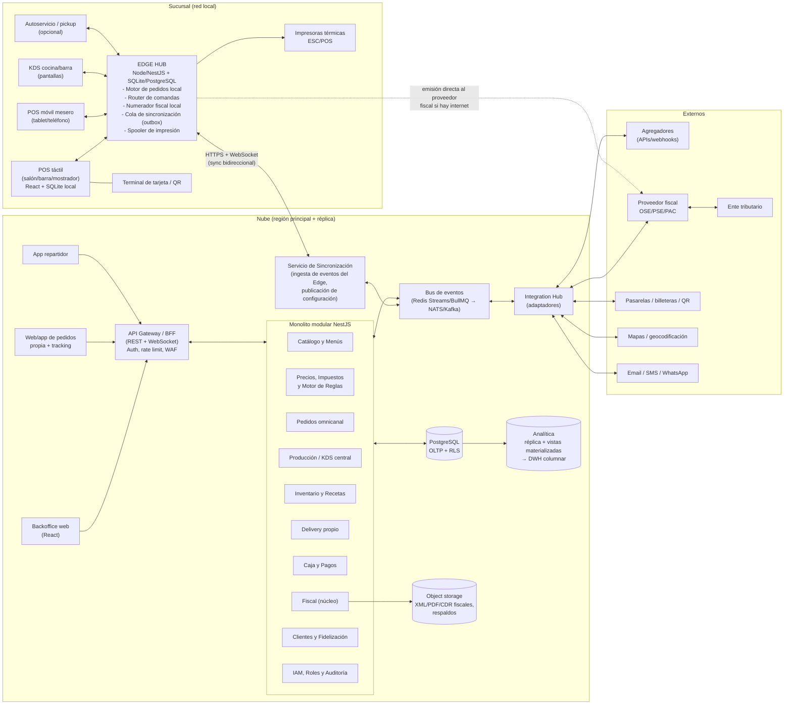
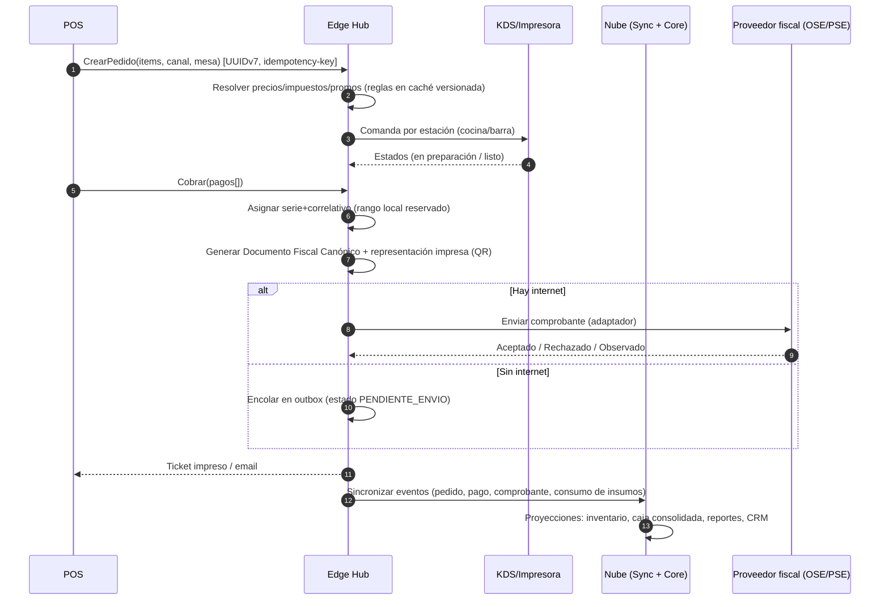
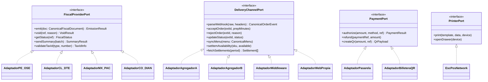

# 01 — Arquitectura, flujo de datos y stack tecnológico

## 1. Principios de arquitectura

| # | Principio | Consecuencia de diseño |
|---|---|---|
| P1 | **La caja nunca se detiene** | Toda operación crítica (pedido, cobro, comanda, comprobante) se completa contra el Edge Hub local; la nube es destino de sincronización, no requisito. |
| P2 | **Hechos inmutables** | Pedidos, pagos, movimientos de caja, movimientos de inventario y comprobantes son *append-only*; las correcciones son nuevos registros (anulación, nota de crédito, ajuste). Base de la trazabilidad y la auditoría. |
| P3 | **Reglas como datos** | Precios, impuestos, series, tipos de comprobante, promociones, recargos y comisiones se configuran por país/marca/formato/sucursal/canal/horario con **vigencias** (`valid_from`/`valid_to`). Nada fiscal se hardcodea. |
| P4 | **Anticorrupción en los bordes** | Agregadores, proveedores fiscales, pasarelas e impresoras se integran mediante *puertos* (interfaces) y *adaptadores*; el dominio sólo conoce modelos canónicos. |
| P5 | **Monolito modular primero** | Un despliegue, módulos con límites estrictos (bounded contexts) y comunicación por eventos internos. Se extraen servicios sólo cuando una métrica lo justifique (carga, ritmo de cambio, equipo). |
| P6 | **Multi-tenant por diseño** | Jerarquía `Grupo (tenant) → Marca → Formato → Sucursal → Terminal`; aislamiento con `tenant_id` + Row-Level Security en PostgreSQL. |
| P7 | **Idempotencia en todo** | IDs generados en el origen (UUIDv7), claves de idempotencia en APIs y webhooks; reintentos seguros. |

## 2. Vista de componentes

### 2.1 Responsabilidad por componente

| Componente | Responsabilidad | Ubicación | Criticidad |
|---|---|---|---|
| POS táctil | Toma de pedidos, mesas, cobro, impresión, operación offline con base local | Dispositivo | Crítica |
| KDS | Recepción y estados de comandas, priorización, tiempos | Dispositivo | Crítica |
| **Edge Hub** | Fuente de verdad local de la sucursal durante el turno: pedidos abiertos, ruteo de comandas, numeración fiscal, cola de emisión/sincronización, spooler de impresión | Mini-PC en sucursal (con UPS) | Crítica |
| API Gateway/BFF | Autenticación, autorización, rate limiting, agregación para frontends | Nube | Alta |
| Monolito modular | Lógica de dominio por módulo (ver archivo 02) | Nube | Alta |
| Servicio de Sincronización | Ingesta idempotente de eventos del Edge; distribución de configuración versionada (catálogo, precios, reglas, usuarios) | Nube | Alta |
| Integration Hub | Adaptadores de agregadores, fiscal, pagos, mensajería; reintentos, DLQ, mapeo de estados | Nube (+ adaptador fiscal también en Edge) | Alta |
| Bus de eventos | Desacople entre módulos e integraciones | Nube | Alta |
| PostgreSQL | OLTP multi-tenant | Nube (primario + réplica síncrona/asíncrona) | Crítica |
| Object storage | XML firmados, constancias de recepción, PDF, respaldos (retención legal) | Nube | Alta |
| Analítica | Reportes y tableros sin cargar el OLTP | Nube | Media |

## 3. Flujo de datos

### 3.1 Flujo principal de una venta (online u offline)

### 3.2 Flujo de configuración (nube → sucursal)

1. El backoffice publica cambios (precio, menú, regla) como una **versión de configuración** con fecha de vigencia.
2. El Servicio de Sincronización empaqueta el delta por sucursal y lo envía al Edge Hub.
3. El Edge Hub aplica la versión atómicamente y la distribuye a POS/KDS; los pedidos ya abiertos conservan la versión con la que se crearon (precio "congelado" en la línea).

### 3.3 Flujo de pedidos externos (agregadores/web propia → sucursal)

Webhook del agregador → Integration Hub (validación de firma, deduplicación, mapeo a Pedido Canónico) → Core Pedidos → Sync → Edge Hub de la sucursal destino → KDS. Los cambios de estado vuelven por el camino inverso al agregador. Detalle en [05_integraciones.md](05_integraciones.md).

## 4. Estrategia offline-first y sincronización

| Aspecto | Diseño | Justificación |
|---|---|---|
| Identificadores | UUIDv7 generados en el dispositivo | Sin colisiones ni dependencia de la nube; ordenables por tiempo. |
| Modelo de datos transaccional | Event log append-only por agregado (pedido, caja, comprobante) + proyecciones | Fusión sin conflictos: los eventos se ordenan, no se sobrescriben. |
| Datos de configuración | Autoridad única: la nube; versión monotónica | Evita conflictos "last-write-wins" en precios o impuestos. |
| Conflictos en pedidos abiertos | Bloqueo optimista en el Edge Hub (versión del pedido); el Edge es autoridad local durante el turno | Dos meseros no pueden editar la misma cuenta con datos desfasados. |
| POS sin Edge Hub (caída del hub) | Modo degradado: POS opera con su SQLite, usa su **propia sub-serie/rango fiscal** de contingencia y reencola al hub | Elimina punto único de falla en caja. [Requiere validación] fiscal del uso de series por terminal. |
| Numeración fiscal offline | **Reserva de rangos**: la nube asigna series por sucursal/terminal; el correlativo se incrementa localmente sin huecos | Nunca dos dispositivos emiten el mismo número. |
| Transporte | Outbox local + entrega "at-least-once" + deduplicación por `event_id` en la nube | Reintentos seguros. |
| Ventana de autonomía objetivo | ≥ 72 h offline sin pérdida de datos | [Supuesto] a validar con el plazo legal de envío de comprobantes. |

## 5. Stack tecnológico recomendado y justificación

| Capa | Elección | Justificación | Alternativa evaluada | Por qué no como primera opción |
|---|---|---|---|---|
| POS / KDS | **React + TypeScript**, empaquetado con **Capacitor** (Android) o **Tauri** (Windows/Linux); SQLite local | Un solo código para POS, KDS, backoffice y web de pedidos; acceso nativo a impresoras, cajón, escáner vía plugins; amplio mercado de talento. | Flutter | Excelente en rendimiento táctil, pero obliga a un segundo lenguaje (Dart) y duplica modelos de dominio respecto al backend TS; elegible si el equipo ya domina Flutter. |
| Backoffice web | React + TypeScript (Vite), librería de componentes accesible | Reutiliza diseño y lógica con POS. | — | — |
| Backend | **Node.js + NestJS** (monolito modular, DDD ligero, CQRS en módulos de alta lectura) | Mismo lenguaje que el frontend; módulos, inyección de dependencias y guards facilitan límites de contexto y permisos; buen soporte de WebSocket para KDS. | Python/FastAPI | Muy productivo; se reserva para analítica, pronósticos y ciencia de datos (fase 4) donde su ecosistema es superior. |
| Edge Hub | NestJS (mismo código de dominio) + SQLite (o PostgreSQL ligero) en mini-PC | Reutiliza el motor de precios/pedidos del core: un solo comportamiento en nube y sucursal. | Lógica sólo en POS | No coordina múltiples dispositivos ni numeración fiscal de forma segura. |
| Base de datos | **PostgreSQL 16+** con RLS, particionamiento por fecha en tablas de hechos, JSONB para atributos variables | ACID para caja y fiscal; RLS para multi-tenant; JSONB permite payloads de agregadores y metadatos fiscales por país sin migraciones constantes. | MySQL / NoSQL | Menor expresividad (RLS, JSONB indexado, particionamiento declarativo). |
| Mensajería | Redis + BullMQ (colas, reintentos) → NATS JetStream o Kafka al escalar | Simple al inicio; ruta clara a un bus robusto. | Kafka desde el día 1 | Sobredimensionado para 3–10 sucursales. |
| Analítica | Réplica de lectura + vistas materializadas → DWH columnar (ClickHouse/BigQuery) en fase 3 | Reportes sin impactar caja. | Reportes sobre OLTP | Riesgo de latencia en horas pico. |
| Identidad | OIDC (Keycloak autogestionado o servicio gestionado) + **PIN/tarjeta** de empleado en POS + MFA para backoffice | Estándar; PIN rápido en caja con permisos por rol. | Auth propia | Riesgo de seguridad innecesario. |
| Infraestructura | Docker; contenedores gestionados (ECS/Cloud Run/App Service) → Kubernetes si >~50 sucursales; IaC con Terraform; CI/CD con GitHub Actions | Bajo costo operativo inicial y reproducibilidad. | Kubernetes desde el inicio | Costo de operación alto para el tamaño inicial. |
| Observabilidad | OpenTelemetry + Prometheus/Grafana + logs centralizados; monitoreo de Edge Hubs (heartbeat) | Detectar sucursales offline, colas fiscales atascadas, latencias. | — | — |
| Impresión | ESC/POS por red (TCP 9100) desde el spooler del Edge Hub; plantillas por país | Independiente de drivers del sistema operativo. | Drivers del SO | Frágil y difícil de soportar en flota. |

## 6. Capa de adaptadores (patrón Puertos y Adaptadores)

Reglas de la capa: (1) cada adaptador es un paquete versionado con su propia suite de pruebas de contrato; (2) se registra por configuración (`tenant` × `país` × `canal`), no por `if` en el código; (3) todo intercambio se persiste crudo (request/response) para auditoría y reproceso; (4) los errores se clasifican en *reintentable* / *no reintentable* / *requiere acción humana*.

## 7. Requisitos no funcionales: cómo se cumplen

| RNF | Objetivo medible | Táctica de arquitectura |
|---|---|---|
| Respuesta < 2 s en operaciones críticas | p95 < 500 ms local (agregar ítem, enviar comanda); p95 < 2 s cobro + impresión; p95 < 3 s emisión en línea (dependiente del proveedor) | Operación contra Edge Hub en LAN; emisión fiscal asíncrona con impresión inmediata de la representación; caché de reglas versionadas. |
| Offline-first | 72 h de autonomía; 0 pérdida de transacciones | Ver §4. |
| Alta disponibilidad caja/facturación | Caja: no depende de la nube. Nube: 99,9% mensual (SLO) | Edge Hub con UPS y modo degradado en POS; nube multi-AZ, réplica de BD, colas persistentes, DLQ. |
| Escalabilidad | Lineal por sucursal | Particionamiento por tenant/fecha; módulos extraíbles; colas. |
| Seguridad | Cifrado TLS 1.2+ en tránsito, AES-256 en reposo; secretos en vault; mínimo privilegio | RLS, RBAC/ABAC por sucursal-formato-función, MFA backoffice, firma de webhooks, rotación de credenciales de proveedores, certificados digitales fiscales en HSM/KMS. |
| Protección de datos personales | Minimización, consentimiento, derecho de acceso/supresión | Datos de cliente en módulo CRM con seudonimización en analítica; registro de consentimiento; políticas de retención. [Requiere validación] con ley local (en Perú, Ley N.º 29733 y su reglamento). |
| Trazabilidad | Reconstrucción completa de pedido → pago → comprobante → inventario | Event log inmutable, `correlation_id` de punta a punta, bitácora de auditoría con hash encadenado. |
| Respaldos | RPO ≤ 5 min (nube), RTO ≤ 1 h; Edge Hub respalda a nube en continuo | Backups PITR de PostgreSQL; outbox del Edge persistente. |

## 8. Topología de despliegue

| Entorno | Propósito | Notas |
|---|---|---|
| Desarrollo | Trabajo diario | Docker Compose con simuladores de agregador y de proveedor fiscal (mocks de contrato). |
| QA / Staging | Pruebas integradas | Conectado a sandboxes del proveedor OSE/PSE y agregadores; datos anonimizados. |
| Piloto | 1 sucursal real | Feature flags por sucursal; monitoreo reforzado. |
| Producción | Todas las sucursales | Despliegue progresivo (canary por sucursal); Edge Hubs actualizados por anillos fuera de horario de servicio. |
