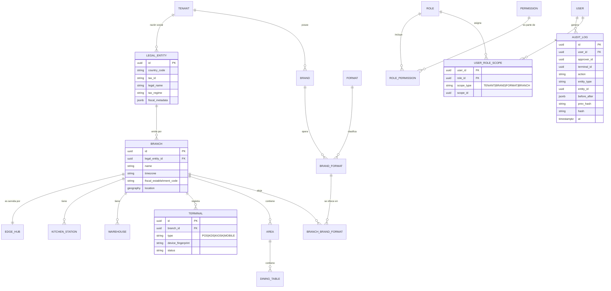
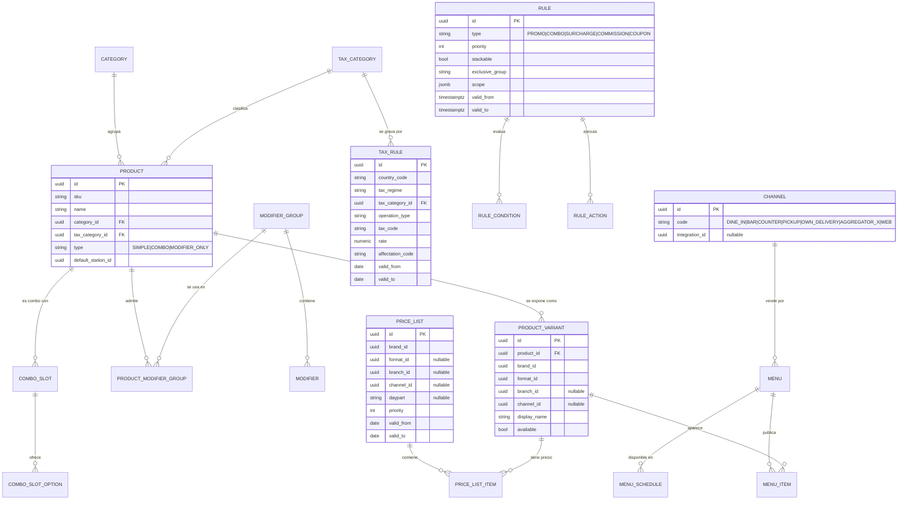
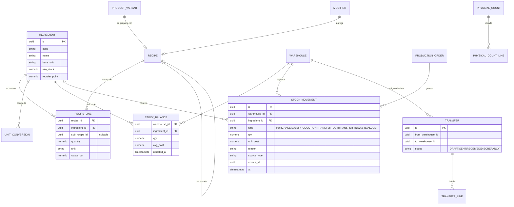
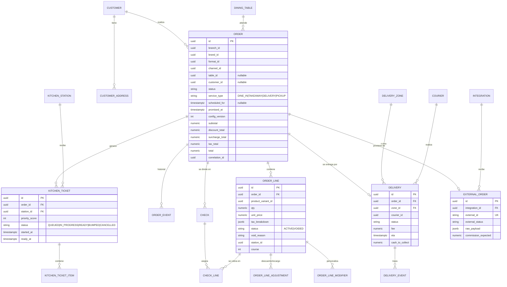
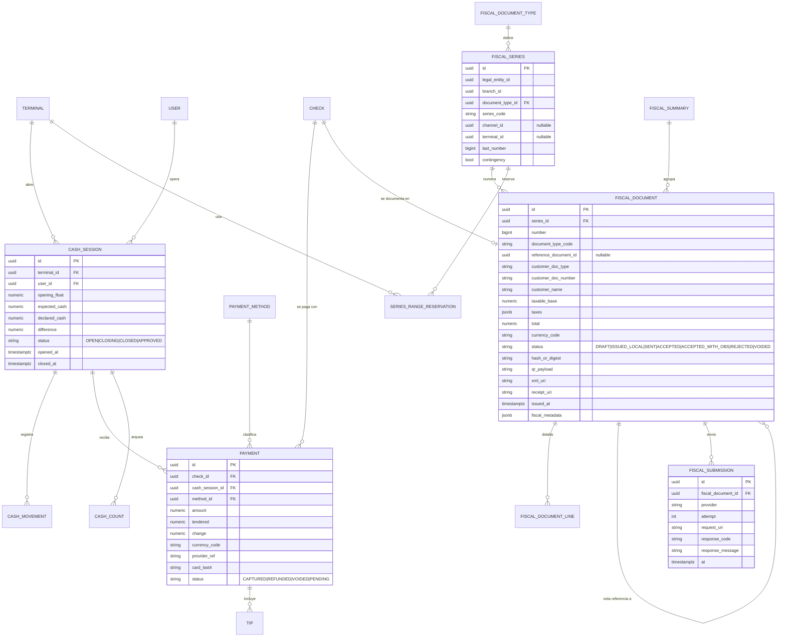
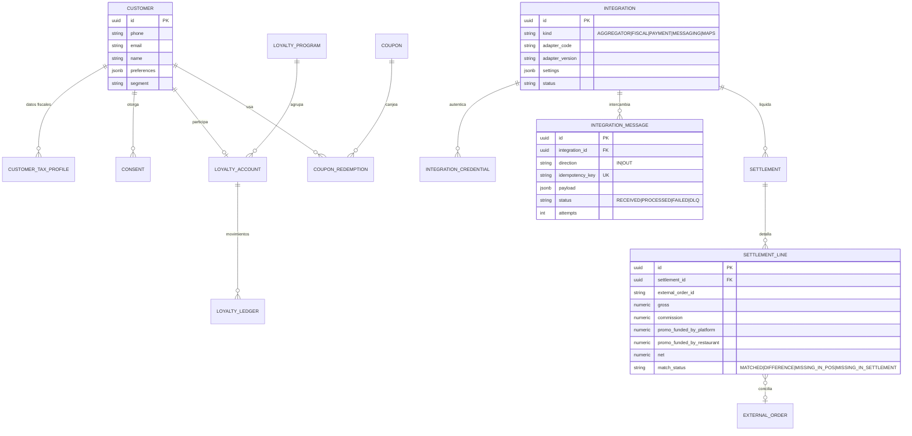

# 03 — Modelo entidad-relación preliminar

**Convenciones** [Recomendación]
- Todas las tablas de negocio llevan `tenant_id` (RLS), `id` UUIDv7, `created_at`, `created_by`, `version` (bloqueo optimista).
- Montos en `NUMERIC(14,4)` con `currency_code`; cantidades de inventario en `NUMERIC(14,6)`.
- Tablas de hechos (pedidos, pagos, movimientos, comprobantes) son **append-only**; correcciones = nuevos registros.
- Configuración con vigencia: `valid_from`, `valid_to`, `config_version`.
- Atributos dependientes del país o del canal en `JSONB` validado por esquema (p. ej. `fiscal_metadata`, `external_payload`).

Por legibilidad, el modelo se divide en 6 dominios. Las relaciones entre dominios se indican con la entidad compartida.

## 1. Organización, seguridad y auditoría

## 2. Catálogo, precios, impuestos y reglas

## 3. Recetas e inventario

## 4. Pedidos, cocina y delivery

## 5. Caja, pagos y facturación electrónica

Restricciones fiscales clave: `UNIQUE(series_id, number)`; `FISCAL_DOCUMENT` no admite `UPDATE` de campos económicos una vez emitido (trigger); toda modificación es nota de crédito/débito o anulación según reglas del país.

## 6. Clientes, fidelización e integraciones

## 7. Volumetría preliminar [Estimación]

Base: 10 sucursales × 800 pedidos/día × 4 líneas/pedido.

| Tabla | Filas/día | Filas/año | Estrategia |
|---|---|---|---|
| ORDER | 8.000 | ~2,9 M | Partición mensual |
| ORDER_LINE | 32.000 | ~11,7 M | Partición mensual |
| ORDER_EVENT | ~64.000 | ~23 M | Partición mensual; archivado a frío > 24 meses |
| STOCK_MOVEMENT | ~100.000 (consumo por insumo) | ~36 M | Partición mensual; consumo agregado por pedido como alternativa |
| FISCAL_DOCUMENT | ~8.500 | ~3,1 M | Partición anual; retención según ley [Requiere validación del plazo] |

Volúmenes manejables en una sola instancia PostgreSQL bien dimensionada durante los primeros años.
