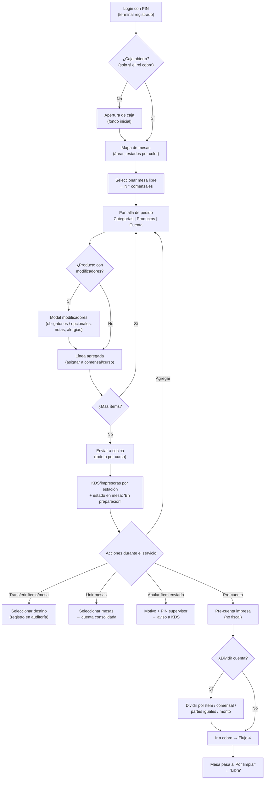
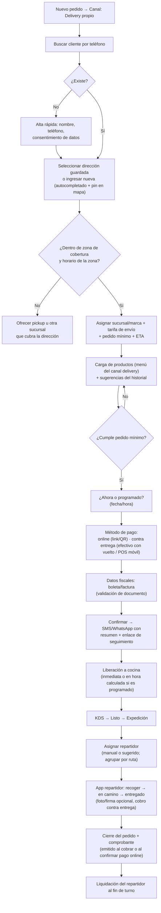
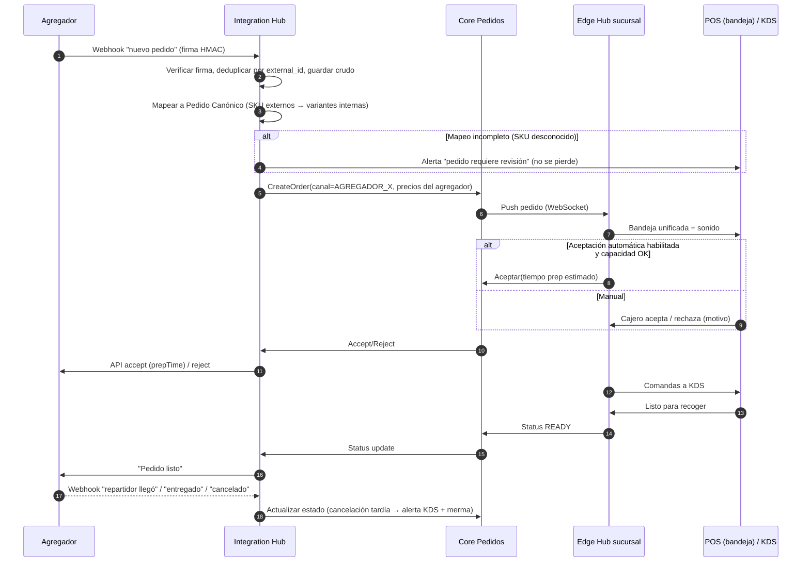
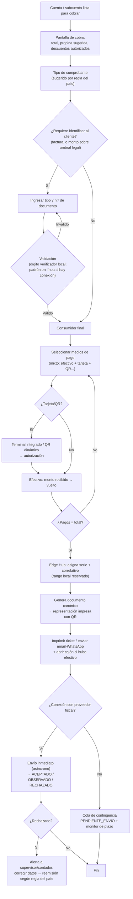
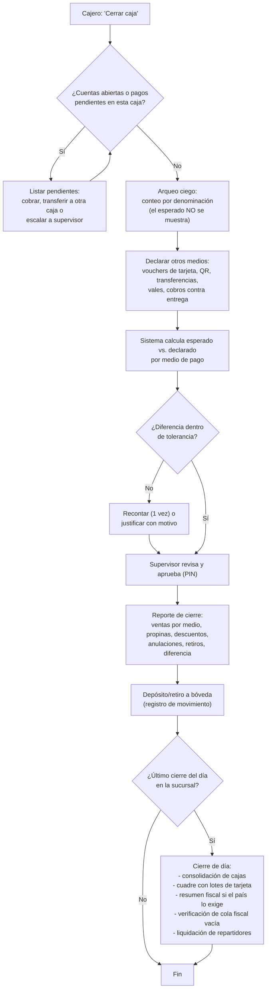

# 04 — Flujos de pantalla

Principios de UX para POS/KDS [Recomendación]: objetivos táctiles ≥ 48 px; máximo 3 toques para agregar un ítem frecuente; acciones destructivas con confirmación y motivo; indicador permanente de estado de conexión (en línea / offline / pendientes de sincronizar) y de cola fiscal; modo alto contraste para cocina; idioma y formato numérico por sucursal.

---

## Flujo 1 — Pedido en salón

**Pantallas clave**

| Pantalla | Elementos | Reglas |
|---|---|---|
| Mapa de mesas | Áreas en pestañas, mesas con color por estado, tiempo de ocupación, mesero, monto acumulado | Arrastrar mesa sobre otra = unir; mantener presionado = menú de acciones |
| Pedido | Barra de búsqueda, categorías, grilla de productos con foto opcional, panel de cuenta con comensales y cursos | Productos agotados ("86") se muestran deshabilitados; precio según canal/franja vigente |
| Modificadores | Grupos con mín./máx. visibles, precio adicional, campo de nota | No permite confirmar si falta un obligatorio |
| División de cuenta | Columnas por subcuenta, arrastrar ítems; ítem compartido dividible en fracciones | La suma de subcuentas debe igualar el total; cada subcuenta genera su propio comprobante |

---

## Flujo 2 — Pedido delivery propio (call center / WhatsApp / mostrador)

---

## Flujo 3 — Integración con agregador (recepción automática)

**Pantalla "Bandeja unificada"**: columnas por estado (Nuevos · En preparación · Listos · En reparto · Entregados), tarjeta con logo del canal, número externo corto, hora prometida, cuenta regresiva, botón aceptar/rechazar, indicador de pago (prepagado / cobrar). Filtros por canal y marca. Interruptor para **pausar canal** o **marcar ítem agotado** que se sincroniza con el agregador.

---

## Flujo 4 — Emisión de comprobante electrónico (cobro)

**Flujo relacionado — Nota de crédito**: Buscar comprobante (n.º, fecha, cliente, QR) → seleccionar motivo del catálogo del país → total o parcial (selección de líneas) → aprobación por rol → reembolso (mismo medio de pago o vale) → emisión de nota con referencia al documento original → reverso de inventario si el producto no se preparó.

---

## Flujo 5 — Cierre de caja

**Pantalla de arqueo**: teclado numérico por denominación (billetes y monedas) con subtotal automático, campos por medio de pago, campo de observaciones, botón "Recontar". Tras aprobar se muestra la diferencia y el reporte se imprime y queda en el backoffice.
