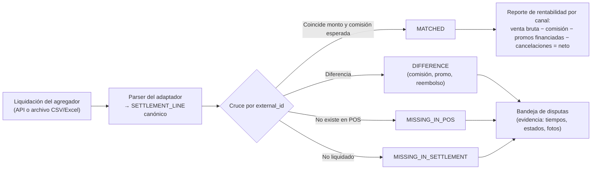
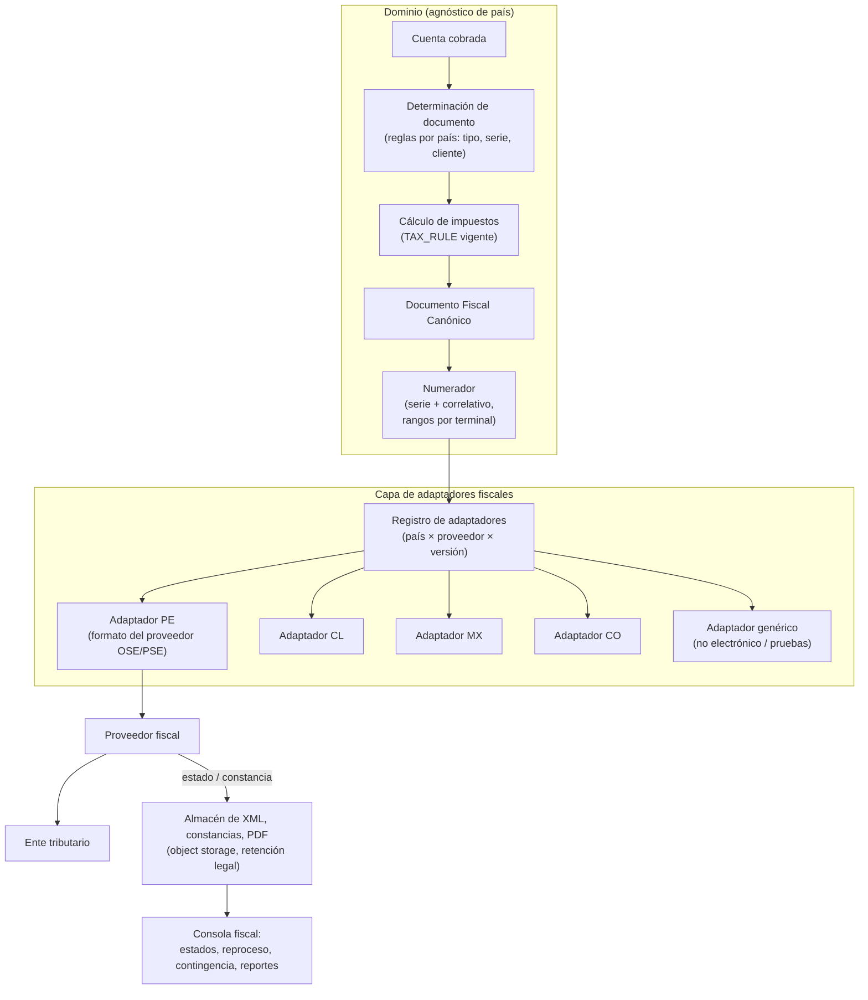
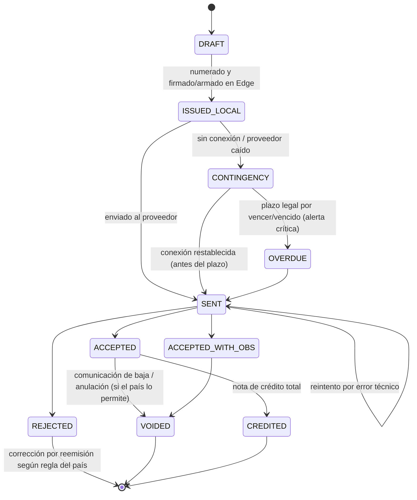

# 05 — Diseño de integración: delivery/agregadores y facturación electrónica

## Parte A — Integración con agregadores y delivery

### A.1 Opciones de integración

| Opción | Descripción | Ventajas | Desventajas | Recomendación |
|---|---|---|---|---|
| A1. API directa por agregador | Adaptador propio por cada plataforma (webhooks + API) | Sin intermediario ni costo por pedido; control total | Requiere convenio de partner y certificación por plataforma; mantenimiento por cambios de API | Para el agregador de mayor volumen |
| A2. Middleware de agregación (terceros) | Un proveedor consolida varias plataformas y expone una sola API | Un solo adaptador; rápida cobertura multi-plataforma | Costo recurrente; dependencia de un tercero; latencia adicional | Si se operan ≥3 agregadores o el convenio directo demora |
| A3. Tablet del agregador + digitación | Sin integración | Costo cero de desarrollo | Errores, doble digitación, sin conciliación automática | Sólo como contingencia |

[Recomendación] Diseñar el puerto `DeliveryChannelPort` de modo que A1 y A2 sean intercambiables. La disponibilidad de APIs y condiciones de cada plataforma en el país **[Requiere validación]** comercial.

### A.2 Modelo de Pedido Canónico (extracto)

```json
{
  "canonical_version": "1.0",
  "source": { "channel": "AGGREGATOR_X", "integration_id": "uuid", "external_id": "AX-123456", "external_display_id": "4F2" },
  "branch_id": "uuid", "brand_id": "uuid",
  "service_type": "DELIVERY",
  "fulfillment": { "by": "PLATFORM | RESTAURANT", "promised_at": "2026-11-25T20:15:00-05:00", "scheduled_for": null },
  "customer": { "name": "Cliente A.", "phone_masked": "***1234", "tax_id": null, "notes": "Sin cebolla" },
  "address": { "line1": "…", "reference": "…", "geo": { "lat": 0, "lng": 0 } },
  "items": [
    { "external_sku": "BURG-01", "variant_id": "uuid|null", "qty": 2, "unit_price": 25.90,
      "modifiers": [{ "external_sku": "EXT-QUESO", "modifier_id": "uuid|null", "qty": 1, "unit_price": 3.00 }],
      "notes": "" }
  ],
  "totals": { "subtotal": 57.80, "platform_discount": 5.00, "restaurant_discount": 0, "delivery_fee": 0, "total_charged_to_customer": 52.80 },
  "payment": { "status": "PREPAID | COLLECT_ON_DELIVERY", "method": "PLATFORM" },
  "fiscal": { "document_requested": "RECEIPT | INVOICE", "issuer_responsibility": "RESTAURANT | PLATFORM" }
}
```

Datos ilustrativos. El campo `fiscal.issuer_responsibility` es clave: quién emite el comprobante al consumidor final y sobre qué monto varía por país y por contrato con la plataforma. **[Requiere validación]** contable/tributaria.

### A.3 Mapeo de estados (ejemplo)

| Estado interno | Evento que lo dispara | Notificación saliente al agregador | Observación |
|---|---|---|---|
| `RECEIVED` | Webhook nuevo pedido | — | Persistido crudo + deduplicado |
| `ACCEPTED` | Aceptación auto/manual | `accept(prep_minutes)` | SLA de aceptación del agregador (p. ej. pocos minutos) [Requiere validación] |
| `REJECTED` | Rechazo con motivo | `reject(reason_code)` | Motivos mapeados a catálogo de la plataforma |
| `IN_PREPARATION` | Primer ticket KDS iniciado | `status(preparing)` si la API lo soporta | |
| `READY` | Expedición completa | `status(ready)` | Activa alerta si el repartidor no llega en X min |
| `PICKED_UP` | Webhook de la plataforma / marcado manual | — | |
| `DELIVERED` | Webhook | — | Cierra pedido |
| `CANCELLED` | Webhook o rechazo | `cancel` si es iniciativa propia | Si ya estaba en preparación → merma + registro para disputa en conciliación |

### A.4 Sincronización de menú y disponibilidad

- **Menú por canal** (`MENU` con `channel_id`): nombres, fotos, precios del canal, modificadores; publicación al agregador mediante `syncMenu()` al aprobar una versión.
- **Tabla de mapeo** `external_sku ↔ variant_id/modifier_id` por integración; pedidos con SKU sin mapeo no se rechazan automáticamente: van a revisión con alerta.
- **Disponibilidad en tiempo real**: marcar "86" en POS/KDS → `setItemAvailability()` a todos los canales; pausar canal completo ante saturación de cocina.
- **Horarios**: horario por canal y sucursal sincronizado con la plataforma.

### A.5 Confiabilidad del Integration Hub

| Mecanismo | Implementación |
|---|---|
| Autenticidad | Verificación de firma (HMAC/OAuth según plataforma), lista de IPs si aplica |
| Idempotencia | `UNIQUE(integration_id, external_id, event_type, event_version)` en `INTEGRATION_MESSAGE` |
| Respuesta rápida | El webhook responde 2xx tras persistir; procesamiento asíncrono en cola |
| Reintentos | Exponencial con jitter; tras N intentos → DLQ + alerta operativa |
| Orden | Procesamiento por `external_id` en orden de recepción; eventos fuera de orden se reordenan por timestamp de la plataforma |
| Reproceso | Consola para reintentar mensajes desde DLQ con trazabilidad |
| Monitoreo | Tasa de webhooks por plataforma; alerta si una sucursal activa deja de recibir pedidos en su horario pico |

### A.6 Conciliación de comisiones y liquidaciones



La comisión esperada se calcula con las reglas tipo `COMMISSION` del motor de reglas (porcentaje, fijo, impuestos sobre la comisión), lo que permite detectar cobros fuera de contrato.

### A.7 Delivery propio: componentes

- **Zonas**: polígonos GeoJSON por sucursal; consulta "punto en polígono" con PostGIS.
- **Geocodificación**: proveedor de mapas mediante adaptador (`MapsPort`) con caché de direcciones de clientes.
- **App repartidor** (PWA o app ligera): lista de entregas, navegación vía app de mapas del teléfono, cambio de estados, cobro contra entrega, envío de ubicación cada N segundos sólo durante la ruta (minimización de datos).
- **ETA** = espera en cola KDS + tiempo de preparación (percentil histórico del producto) + traslado estimado (zona o API de rutas).
- **Integración opcional con flotas de terceros** (última milla bajo demanda) mediante el mismo patrón de adaptador.

---

## Parte B — Facturación electrónica parametrizable por país

### B.1 Arquitectura fiscal



### B.2 Parametrización por país (sin hardcode)

| Parámetro (tabla/config) | Ejemplo de contenido | Uso |
|---|---|---|
| `fiscal_document_type` | Código oficial, nombre, si requiere identificación, si admite consumidor final, plantilla de impresión | Catálogo de comprobantes por país |
| `fiscal_doc_determination_rule` | "Si cliente tiene identificador tributario de empresa → factura; si no → boleta; si monto > umbral → exigir documento de identidad" | Sugerencia automática en el cobro |
| `tax_rule` | Tributo, tasa, base, código de afectación, vigencia, régimen | Cálculo de impuestos |
| `customer_id_type` | Tipos de documento de identidad, longitud, algoritmo de dígito verificador | Validación local offline |
| `fiscal_series_policy` | Formato de serie, alcance (sucursal/terminal/canal), prefijo de contingencia | Numeración |
| `submission_policy` | Envío individual o por resumen diario, plazo máximo de envío, ventana de anulación | Cola y monitor de plazos |
| `void_policy` | Anulación por comunicación de baja vs. obligatoriedad de nota de crédito, motivos válidos | Flujo de anulaciones |
| `print_template` | Campos obligatorios en representación impresa, formato de QR | Ticket |
| `rounding_policy` | Redondeo por línea o por total, decimales | Consistencia con el validador del ente |

**Ilustración por país** (referencial; **todo [Requiere validación]** con normativa vigente y con el proveedor elegido):

| País | Esquema general conocido | Actor intermedio habitual |
|---|---|---|
| Perú (piloto) | Comprobantes de pago electrónicos SUNAT en formato UBL; facturas y boletas; resúmenes diarios para boletas y comunicaciones de baja; tasas IGV con regímenes especiales para restaurantes MYPE e impuesto a las bolsas de plástico | OSE / PSE |
| Chile | Documentos Tributarios Electrónicos del SII (incluye boleta electrónica) | Proveedor de facturación certificado / emisión propia |
| México | CFDI del SAT, facturas globales para ventas a público en general | PAC |
| Colombia | Factura electrónica y documento equivalente POS electrónico de la DIAN | Proveedor tecnológico |

### B.3 Ciclo de vida del comprobante



### B.4 Contingencia y alta disponibilidad fiscal

| Escenario | Comportamiento |
|---|---|
| Sin internet en la sucursal | Edge Hub emite localmente con su rango reservado, imprime representación con datos y QR, encola envío; monitor de plazo por documento. |
| Proveedor OSE/PSE no disponible | Reintentos con backoff; si persiste más de X horas → alerta; opción de **proveedor secundario** (segundo adaptador configurado) [Recomendación, sujeta a viabilidad contractual y técnica]. |
| Caída del Edge Hub | POS usa sub-serie de contingencia propia (rango reservado al terminal) y reencola al hub al volver. [Requiere validación] de que el uso de series por terminal/contingencia es aceptado en el país. |
| Rechazo del documento | No se "edita": se registra el rechazo, se notifica a contabilidad y se corrige por el mecanismo que defina el país. |
| Agotamiento de rango local | Alerta al llegar al 80% de uso; la nube asigna un nuevo rango al reconectar; si el rango se agota offline, el terminal bloquea sólo la emisión de ese tipo de documento (no la toma de pedidos). |

### B.5 Seguridad fiscal

- Certificado digital de firma (cuando lo emite el contribuyente) almacenado en KMS/HSM; nunca en el dispositivo POS. Si la firma debe hacerse en el Edge para operar offline, se usa almacén protegido por hardware (TPM) y rotación controlada [Requiere validación de viabilidad con el proveedor].
- Credenciales del proveedor por razón social, en vault, con rotación.
- Inmutabilidad: documento emitido no modificable (triggers + permisos); toda acción en bitácora con hash encadenado.
- Retención de XML y constancias por el plazo legal del país en almacenamiento WORM (escritura única).

### B.6 Pruebas de contrato y certificación

1. Suite de pruebas por adaptador con casos oficiales: boleta simple, factura con varias tasas, operación exonerada/inafecta, descuento global, nota de crédito parcial, anulación, contingencia, redondeos extremos.
2. Homologación en sandbox del proveedor antes de piloto; evidencia archivada.
3. Pruebas de regresión fiscal automáticas en cada despliegue (golden files de XML/JSON esperados).
4. Validación final con contador/tributarista: firma de checklist fiscal por país antes de salir a producción.

---

## Parte C — Otras integraciones

| Integración | Puerto | Notas |
|---|---|---|
| Pasarelas de pago / terminales de tarjeta | `PaymentPort` | Integración semi-integrada (el terminal procesa la tarjeta; el POS sólo recibe resultado) para minimizar alcance PCI DSS. |
| QR y billeteras | `PaymentPort` | QR dinámico por monto con confirmación por webhook o consulta; conciliación diaria. |
| Impresoras térmicas | `PrinterPort` | ESC/POS por red; plantillas por país/marca; cola con reintento y reimpresión. |
| Lectores de código de barras | HID teclado | Búsqueda de producto/cupón en POS. |
| Email/SMS/WhatsApp | `MessagingPort` | Envío de comprobantes, seguimiento de pedidos; sólo con consentimiento cuando sea marketing. |
| Contabilidad/ERP | `AccountingExportPort` | Asientos resumen diarios por sucursal (ventas, impuestos, medios de pago, comisiones). |
