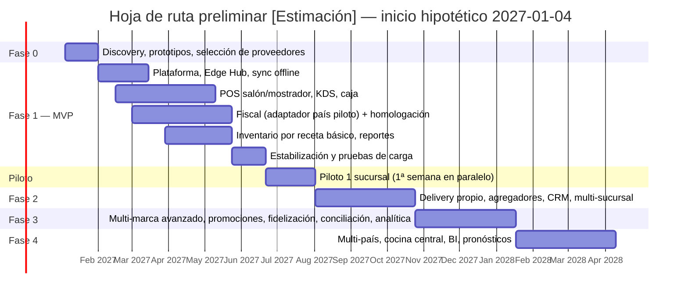

# 07 — Plan de implementación por fases

## 1. Hoja de ruta



## 2. Detalle por fase

| Fase | Duración [Estimación] | Objetivo | Alcance principal (IDs del backlog) | Entregables | Criterio de salida (go/no-go) |
|---|---|---|---|---|---|
| **0. Discovery** | 4 semanas | Reducir incertidumbre crítica | Respuestas a preguntas críticas; selección OSE/PSE, hardware y agregadores; prototipos navegables de los 5 flujos; arquitectura detallada; backlog MVP refinado | Documento de decisiones (ADR), prototipo probado con ≥5 cajeros/meseros, plan de pruebas fiscal | Proveedor fiscal con sandbox operativo; prototipo con tasa de éxito ≥ 90% en tareas clave; presupuesto aprobado |
| **1. MVP** | 20 semanas | Operar una sucursal de punta a punta, legalmente, con o sin internet | E1-01…06, E2-01…05, E3-01…05, E4-01…07, E5-01…04, E7-01…06, E8-01…08, E10-01…03 | POS salón/barra/mostrador, KDS, caja, comprobantes electrónicos del país piloto, inventario por receta, reportes operativos y fiscales, Edge Hub, backoffice | 100% de criterios de aceptación Must (archivo 08); homologación fiscal aprobada; prueba de 72 h offline sin pérdida; p95 dentro de objetivo |
| **Piloto** | 6 semanas | Validar en operación real | 1 sucursal de formato representativo; 1ª semana en paralelo con el sistema actual | Informe de piloto con KPIs, lista de defectos y ajustes | Sin incidentes fiscales críticos; ≥ 98% de comprobantes aceptados en primer envío; cierre de caja en ≤ 15 min; satisfacción del personal ≥ 4/5 |
| **2. Omnicanal** | 12 semanas | Delivery y agregadores; despliegue multi-sucursal | E1-07, E2-06/07/09, E3-06…08, E4-08…10, E5-05/06, E6-01…06/09, E7-07, E8-09, E9-01/02, E10-04 | Bandeja unificada, integración con 1–2 agregadores, delivery propio con app repartidor, CRM básico, transferencias | ≥ 99% de pedidos de agregador ingresados sin digitación; despliegue en ≥ 3 sucursales |
| **3. Multi-marca y crecimiento** | 12 semanas | Explotar el modelo multi-formato | E2-08, E3-09, E4-11, E5-07/08, E6-07/08, E7-08, E9-03…05, E10-05/06 | Promociones avanzadas, fidelización, conciliación de liquidaciones, dark kitchen multi-marca, web de pedidos propia, analítica de márgenes | Conciliación automática ≥ 95% de líneas; v1.0 completa |
| **4. Escalamiento** | Continuo (trimestres) | Expansión y ventaja analítica | E8-10/11, cocina central avanzada, DWH, pronóstico de demanda (Won't de v1.0 re-priorizados) | Segundo país, proveedor fiscal secundario, BI | Según caso de negocio de cada iniciativa |

**Total hasta v1.0:** ~54 semanas (~12,5 meses) [Estimación], con valor operativo desde la semana 24–30.

## 3. Equipo propuesto

| Rol | Fase 0 | Fase 1 | Fase 2–3 | Responsabilidad clave |
|---|---|---|---|---|
| Product Owner (negocio) | 1 | 1 | 1 | Prioridad, aceptación, decisiones de alcance |
| Arquitecto / Tech Lead | 1 | 1 | 1 | Arquitectura, offline/sync, calidad técnica |
| Backend (NestJS) | 1 | 3 | 3 | Dominio, integraciones, fiscal |
| Frontend (React POS/KDS/backoffice) | 1 | 3 | 3 | UI táctil, offline, hardware |
| QA automatización | — | 1 | 1 | Pruebas E2E, contrato, carga, regresión fiscal |
| DevOps / SRE | 0,5 | 1 | 0,5 | Infra, CI/CD, Edge Hubs, observabilidad |
| Diseñador UX/UI | 1 | 0,5 | 0,5 | Prototipos, pruebas con usuarios |
| Consultor tributario | 0,25 | 0,25 | 0,1 | Validación normativa y homologación |
| Analista funcional / implementador | 0,5 | 1 | 1 | Configuración, carga de catálogo/recetas, capacitación |
| **Total FTE** | **~6,25** | **~11,75** | **~11,1** | |

## 4. Esfuerzo y presupuesto (orden de magnitud)

| Bloque | Cálculo [Estimación] | Persona-mes |
|---|---|---|
| Fase 0 | 6,25 FTE × 0,9 meses | ~6 |
| Fase 1 | 11,75 FTE × 4,6 meses | ~54 |
| Piloto | ~8 FTE × 1,4 meses | ~11 |
| Fase 2 | 11,1 FTE × 2,8 meses | ~31 |
| Fase 3 | 11,1 FTE × 2,8 meses | ~31 |
| **Total hasta v1.0** | | **~133** |

**Fórmula de presupuesto** (completar con tarifas reales; no se asumen tarifas en este documento):

```
Costo_v1.0 = Σ(persona-mes × tarifa_mensual_rol)
           + Infra_nube_mensual × meses
           + Hardware_por_sucursal × n_sucursales   (Edge Hub + UPS + tablets/POS + KDS + impresoras + red)
           + Licencias/servicios (proveedor fiscal por documento o plan, mapas, mensajería, middleware agregadores, pasarela)
           + Contingencia 15–20%
```

Para el análisis de **TCO a 3 años** comparar contra el costo de licencias SaaS por terminal/sucursal × n.º de sucursales proyectado; el punto de equilibrio suele depender más del número de sucursales que del costo de construcción. [Recomendación] Modelar escenarios pesimista/base/optimista de crecimiento de sucursales.

## 5. Estrategia de despliegue y gestión del cambio

| Elemento | Plan |
|---|---|
| Migración de datos | Catálogo, recetas, clientes y saldos de stock desde el sistema actual vía plantillas Excel validadas; sin migrar historial transaccional fiscal (se mantiene consultable en el sistema anterior). |
| Corte | Fuera de horario de servicio, al inicio de un periodo fiscal o de una semana operativa; plan de reversión documentado. |
| Capacitación | Por rol (mesero 1 h, cajero 2 h, cocina 30 min, administrador 4 h, contador 3 h); modo entrenamiento en POS que no emite comprobantes reales. |
| Soporte | Hypercare de 2 semanas por sucursal con soporte en sitio el primer día; mesa de ayuda con SLA definido. |
| Despliegue progresivo | Anillos: piloto → 2 sucursales → resto en olas de 3–5; feature flags por sucursal y canal. |
| Gobernanza | Comité quincenal (Gerencia, Operaciones, Finanzas, TI) con tablero de KPIs del proyecto: avance de SP, defectos críticos abiertos, tasa de aceptación fiscal, incidentes por sucursal. |

## 6. KPIs de éxito del proyecto

| KPI | Línea base | Meta | Fuente |
|---|---|---|---|
| Tiempo promedio de toma de pedido en salón | [Requiere medición en Fase 0] | −20% | Logs del POS |
| Comprobantes aceptados al primer envío | — | ≥ 98% | Consola fiscal |
| Pedidos de agregador digitados manualmente | [Requiere medición] | ≤ 1% | Integration Hub |
| Tiempo de cierre de caja | [Requiere medición] | ≤ 15 min | Sesiones de caja |
| Diferencia de inventario teórico vs. real (insumos críticos) | [Requiere medición] | ≤ 3% | Inventario físico |
| Disponibilidad percibida de caja (minutos sin poder cobrar/mes) | — | 0 | Monitoreo Edge |
